Agenda
---
* Information
    * Schedule Next Meeting
    * Talk About The Rec Sheet
    * Chat Changes
* Kansai
    * Osaka (+Nara)
        * Schedule Overview
        * Reserve: Shuttle
        * Reserve: Hama Chan
        * Reserve: USJ
        * Reserve: Wa Yamamura
    * Kyoto
        * Schedule Overview
        * Reserve: Ichiho Sushi, Hikiniku To Come, others?
* Kanto
    * Tokyo
        * Discuss Team Labs

<!-- end_slide -->

Calendar
---
| Sun   | Mon      | Tue   | Wed          | Thu   | Fri   | Sat   |
|-------|----------|-------|--------------|-------|-------|-------|
|       | 14       | 15    | 16           | 17    | 18    | 19    |
|       | ARRIVE   | OSAKA | OSAKA/HIMEJI | NARA  | OSAKA | KYOTO |
|       |          |       |              |       |       |       |
| 20    | 21       | 22    | 23           | 24    | 25    | 26    |
| KYOTO | KINOSAKI | TOKYO | TOKYO        | TOKYO | TOKYO | TOKYO |
|       |          |       |              |       |       |       |
| 27    | 28       |       |              |       |       |       |
| TOKYO | DEPART   |       |              |       |       |       |

<!-- end_slide -->

Osaka Schedule
---
A hopefully quick overview...

<!-- end_slide -->

Mon, Dec 14
---
**The Day of Arrival**
| Time | Duration | Event |
|---|---|---|
| ~5 PM🙏 | ~3h | Land, customs, figure out airport... (big buffer here) |
| ~8:00 PM | 1h | Private shuttle to airbnb, drop off bags |
| 9:00 PM | 1h 30m | Hama Chan (booked dinner) |
| 10:30 PM |  | Sleep |
<!-- end_slide -->
Mon, Dec 14
---
<!-- column_layout: [1, 1, 1] -->
<!-- column: 0 -->
KIX
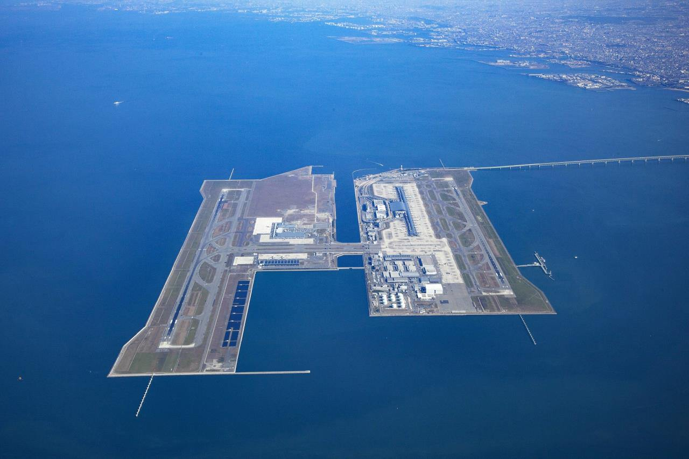
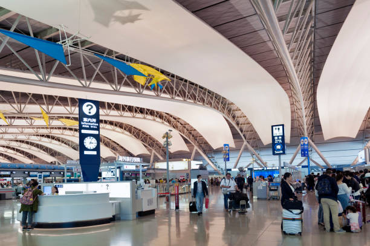
<!-- pause -->
<!-- column: 1 -->
Shuttle
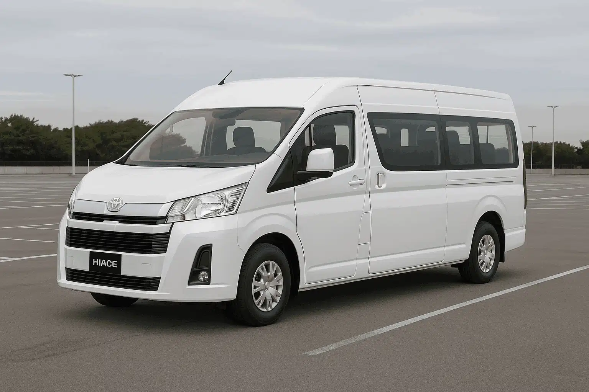
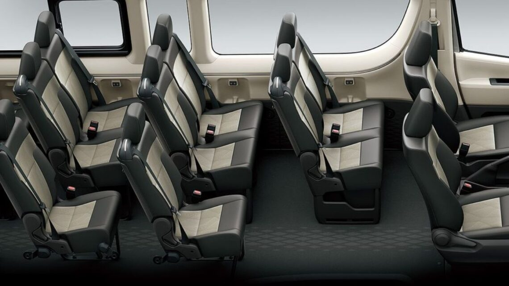
<!-- pause -->
<!-- column: 2 -->
Hama Chan
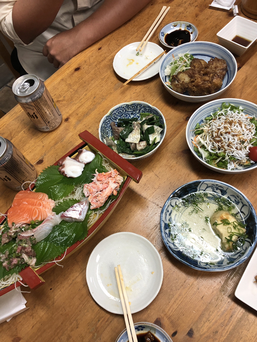
<!-- end_slide -->
Mon, Dec 14
---
Complete
<!-- end_slide -->

Tue, Dec 15
---
**Kujou, Namba, Dotonbori (lazy drinking day) (strictness: NONE)**
| Time | Duration | Event |
|---|---|---|
| 8:00 AM | 4h | Get situated, maybe unplanned ventures |
| Noon | 2h | Kirara Kujou Shopping Street (lunch) |
| 2:00 PM | 10m | `Kujou -(train)-> Namba` |
| ~2:00 PM | 8h | Naniwa (Namba -> Dotonbori) (dinner) |
| ~10:00 PM |  | Sleep |
<!-- end_slide -->
Tue, Dec 15
---
Kirara Kujou Shopping Street (Noon - 2 PM)
<!-- column_layout: [1, 2] -->
<!-- column: 0 -->
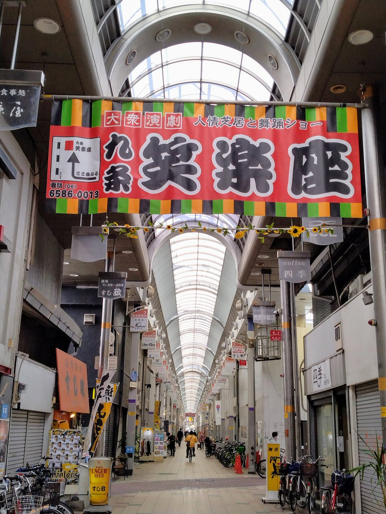
<!-- column: 1 -->
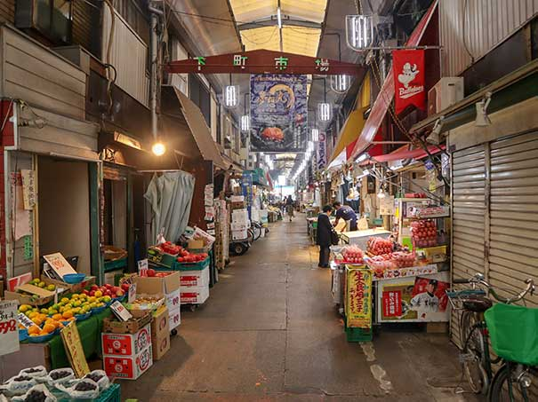
<!-- end_slide -->
Tue, Dec 15
---
Namba (2 PM - 5 PM or later)
# Namba Parks Shopping Mall
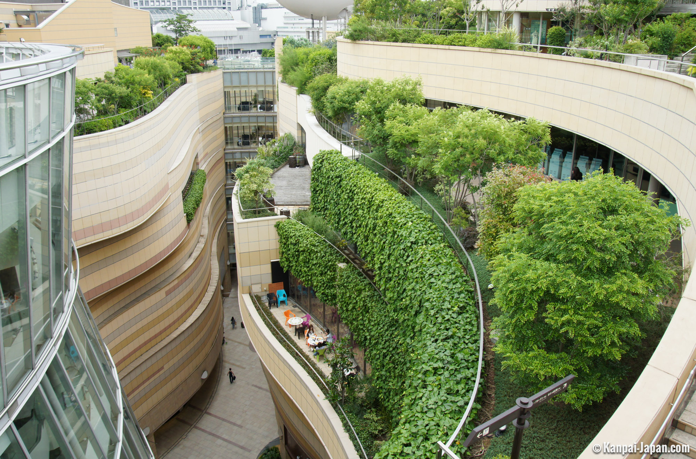
<!-- end_slide -->
Tue, Dec 15
---
Namba (2 PM - 5 PM or later)
# Namba Shrine
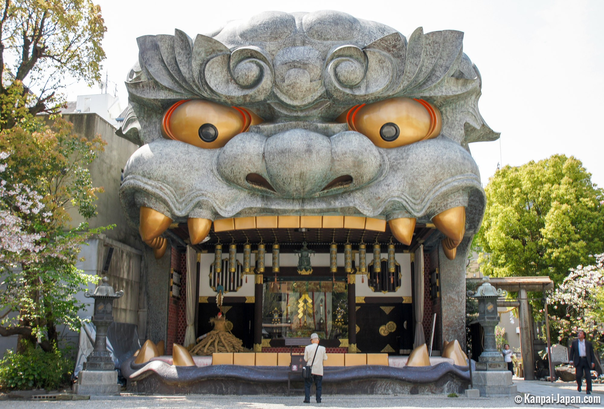
<!-- end_slide -->
Tue, Dec 15
---
Namba (2 PM - 5 PM or later)
# Amerikamura
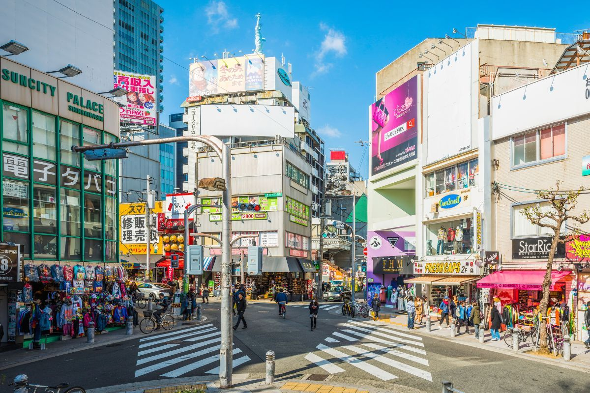
<!-- end_slide -->
Tue, Dec 15
---
Namba (2 PM - 5 PM or later)
# Den Den Town
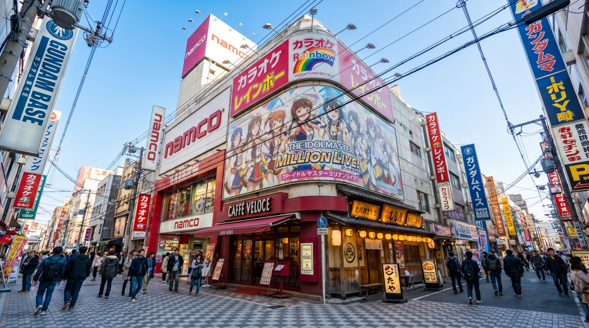
<!-- end_slide -->
Tue, Dec 15
---
Dotonbori (5 PM or earlier - 10 PM)
# Kuromon Market
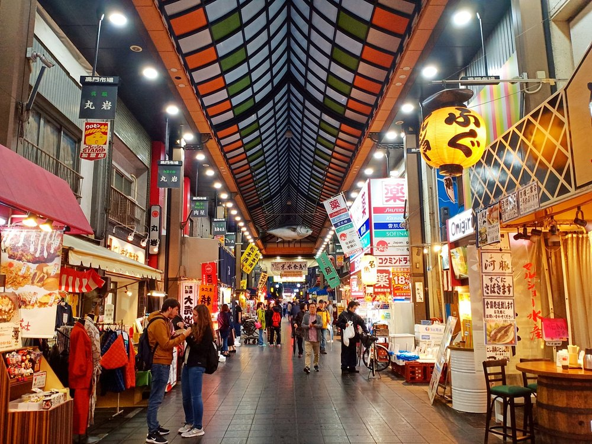
<!-- end_slide -->
Tue, Dec 15
---
Dotonbori (5 PM or earlier - 10 PM)
# Ebisu Bridge, Tonbori River
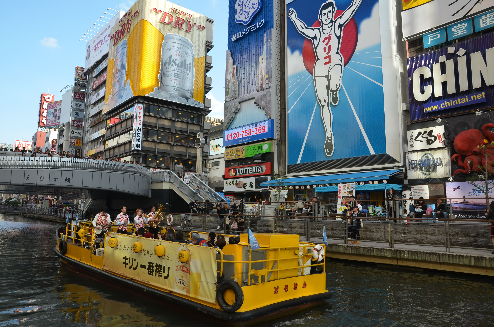
<!-- end_slide -->
Tue, Dec 15
---
Dotonbori (5 PM or earlier - 10 PM)
# Houzenji Yokochou
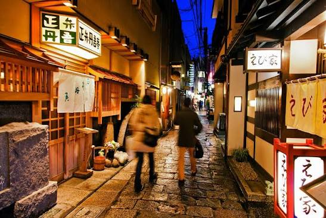
<!-- end_slide -->
Tue, Dec 15
---
Dotonbori (5 PM or earlier - 10 PM)
# If you know...
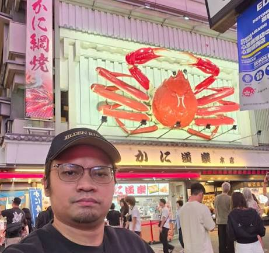
<!-- end_slide -->
Tue, Dec 15
---
Dotonbori (5 PM or earlier - 10 PM)
# Dotonbori Don Quixote (DonKi)
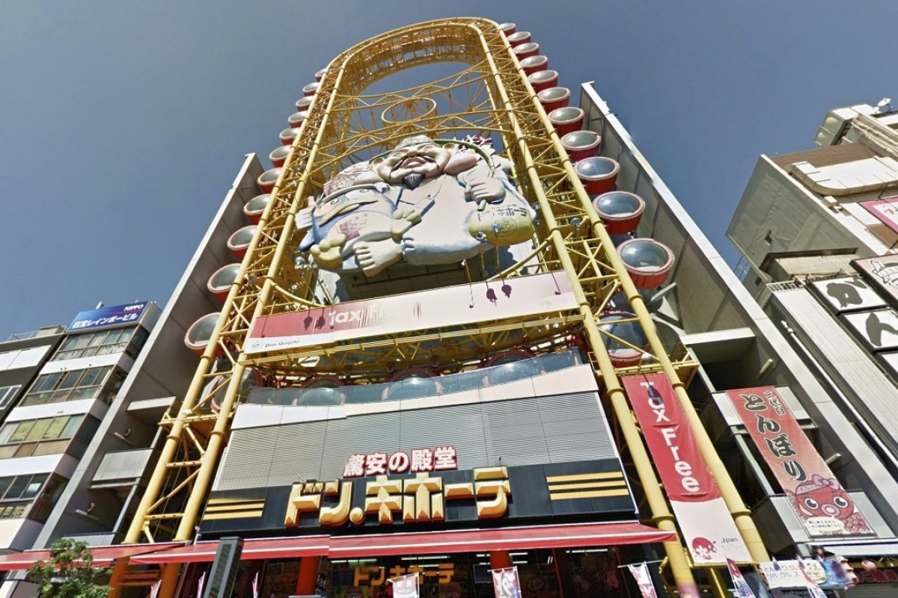
<!-- end_slide -->
Tue, Dec 15
---
Complete
<!-- end_slide -->

Wed, Dec 16
---
**Osaka Castle, Shinsekai, Himeji (Busy castle day) (strictness: You can skip the start, but we get together in Shinsekai or you get left)**
| Time | Duration | Event |
|---|---|---|
| 8:30 AM | 25m | Pack an overnight bag! |
| 8:55 AM | 35m | `Kujou -(train)-> Osaka Castle` |
| 9:30 AM | 1h 15m | Osaka Castle Grounds |
| 10:45 AM | 15m | `Morinomiya -(train)-> Tennouji` |
| 11:00 AM | 2h 10m | Shitennouji & Shinsekai (lunch/snacks) |
| 1:10 PM | 1h 50m | `Tennouji -(train,train)-> Himeji Sta` |
| 3:00 PM | 30m | Checkin / drop daybag at Koko Hotel |
| 3:30 PM | 1h 30m | Himeji Castle Main Keep (entry before 4 PM) |
| 5:00 PM | 1h | Sannomaru Square Illuminations |
| 6:00 PM | 2h | Otemae St (dinner) |
| 8:00 PM | 2h | Late castle grounds stroll |
| 10:00 PM | | Sleep |
<!-- end_slide -->
Wed, Dec 16
---
# Osaka Castle
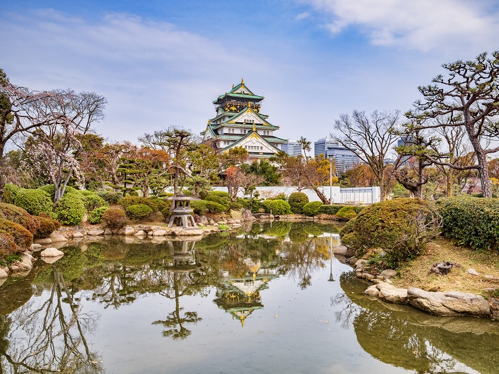
<!-- end_slide -->
Wed, Dec 16
---
# Osaka Castle - Toyotomi Stone Wall Museum
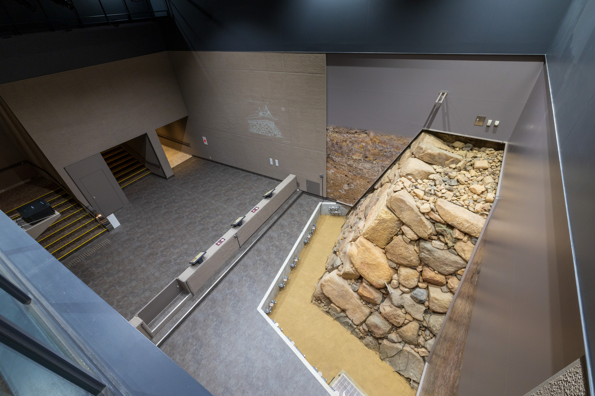
<!-- end_slide -->
Wed, Dec 16
---
# Shitenouji Temple
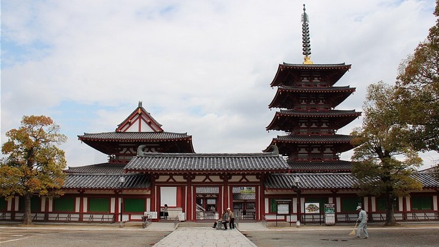
<!-- end_slide -->
Wed, Dec 16
---
# Shensekai
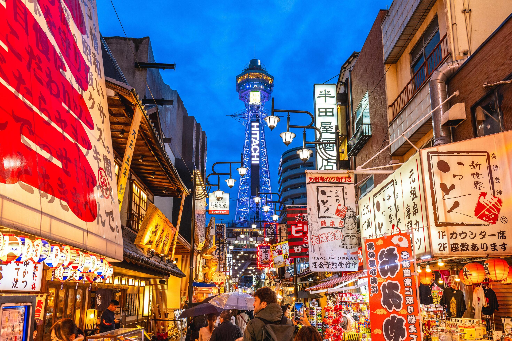
<!-- end_slide -->
Wed, Dec 16
---
# Train to Himeji
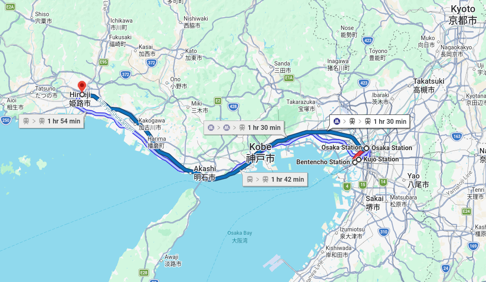
<!-- end_slide -->
Wed, Dec 16
---
# Himeji Castle (White Heron Castle)
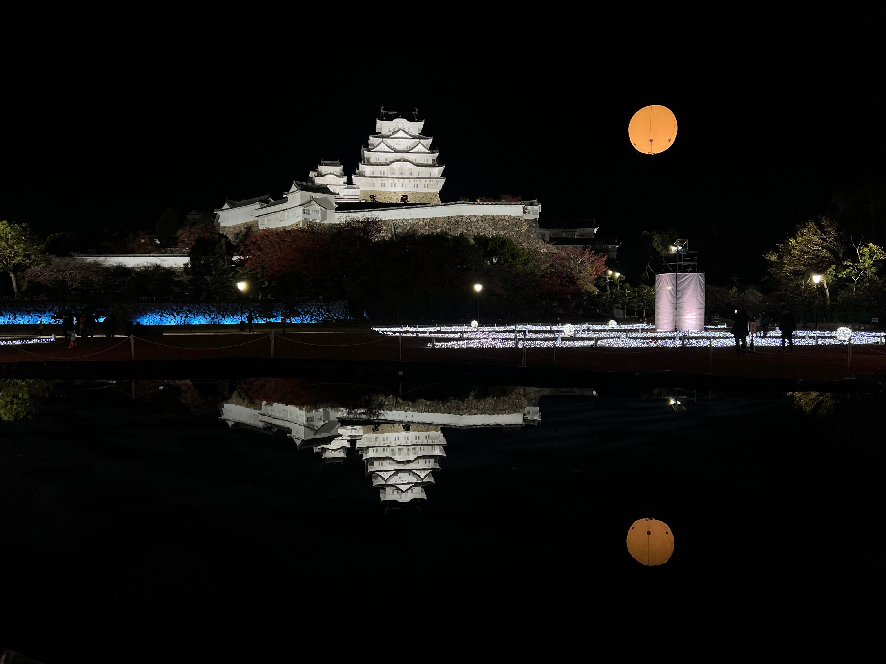
<!-- end_slide -->
Wed, Dec 16
---
Complete
<!-- end_slide -->

Thu, Dec 17
---
**Nara Daytrip (strictness: be on time for lunch, everything else is loose)**
| Time | Duration | Event |
|---|---|---|
| ~8:00 AM | 1h 30m | Quick stroll around Himeji in the day, then checkout |
| 9:30 AM | 2h 20m | `Himeji -(train,train)-> Shin-Oomiya` |
| Noon | 2h | Wa Yamamura (booked lunch) |
| 2:00 PM | 30m | `Walk or Kitasoegawa -(bus)-> Todaiji Daibutsuden` |
| 2:30 PM | 2h 30m | Todaiji, Kasugataisha |
| 5:00 PM | 30m | Walk to Naramachi |
| 5:30 PM | 3h 30m | Naramachi (dinner) |
| 9 PM | 1h 15m | Kintetsu-Nara -(train)-> Kujou |
| ~10:15 PM |  | Sleep |
<!-- end_slide -->
Thu, Dec 17
---
# Wa Yamamura
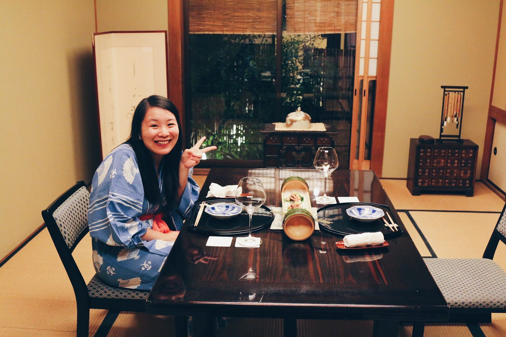
<!-- end_slide -->
Thu, Dec 17
---
# Todaiji Temple
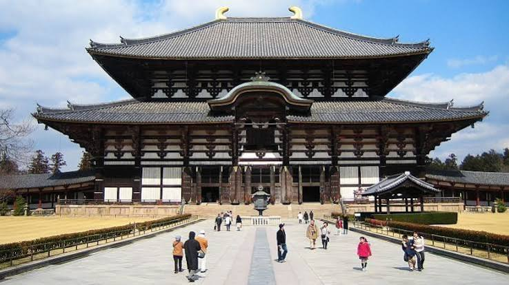
<!-- end_slide -->
Thu, Dec 17
---
# Kasugataisha Shrine
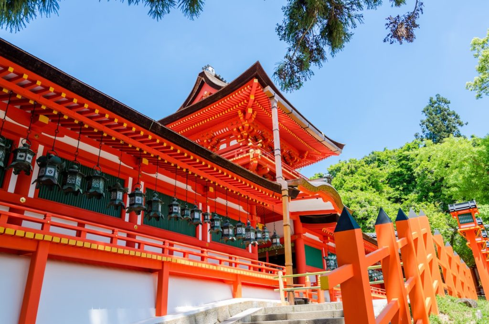
<!-- end_slide -->
Thu, Dec 17
---
# Nara Deer
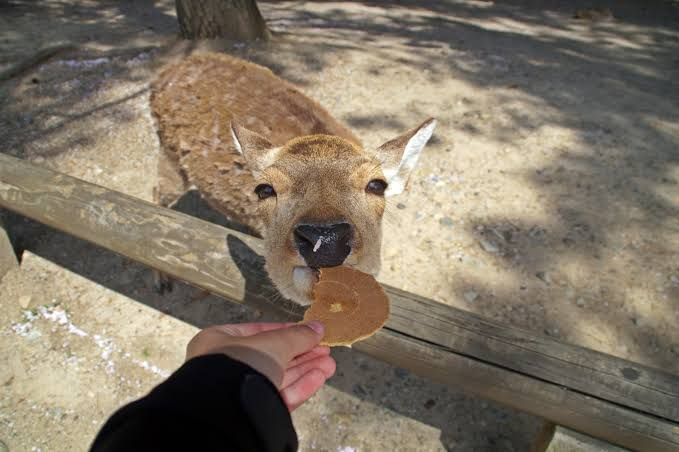
<!-- end_slide -->
Thu, Dec 17
---
# Naramachi
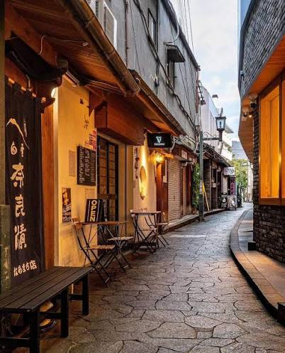
<!-- end_slide -->
Thu, Dec 17
---
Complete
<!-- end_slide -->

Fri, Dec 18
---
**USJ Crew Only! (strictness: pretty tight)**
| Time | Duration | Event |
|---|---|---|
| ~9:00 AM | 15m | `Nishikujou -(train)-> Universal-City` |
| 9:15 AM | 7h 45m | USJ |
| 5:00 PM | 15m | `Universal-City -(train)-> Osaka Sta` |
| 5:15 PM | 1h 15m | Umeda Sky Building |
| 6:30 PM | 1h 40m | Takimikoji Underground Retro Market (dinner) |
| 8:40 PM | 20m | `Walk to Sonezaki` |
| 9 PM | 2h | Sonezaki |
| 11 PM | 30m | `Osaka Sta -(train)-> Nishikujou` |
| ~11:30 PM |  | Sleep |
<!-- end_slide -->
Fri, Dec 18
---
**Hiking Crew Only! (strictness: probably pretty tight?)**
| Time | Duration | Event |
|---|---|---|
| ~7:30 AM | 9h 30m | Hiking Tour |
| 5:15 PM | 1h 15m | Umeda Sky Building |
| 6:30 PM | 1h 40m | Takimikoji Underground Retro Market (dinner) |
| 8:40 PM | 20m | `Walk to Sonezaki` |
| 9 PM | 2h | Sonezaki |
| 11 PM | 30m | `Osaka Sta -(train)-> Nishikujou` |
| ~11:30 PM |  | Sleep |
<!-- end_slide -->
Fri, Dec 18
---
# USJ
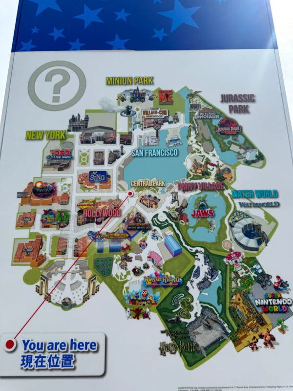
<!-- end_slide -->
Fri, Dec 18
---
# Umeda Sky Building
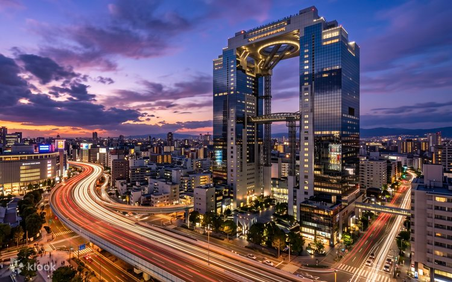
<!-- end_slide -->
Fri, Dec 18
---
# Takimikoji
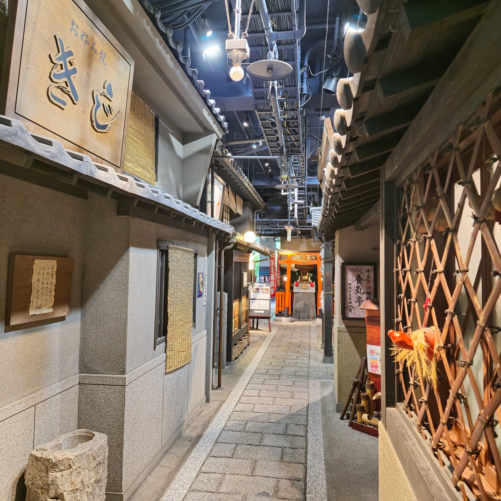
<!-- end_slide -->
Fri, Dec 18
---
# Sonezaki
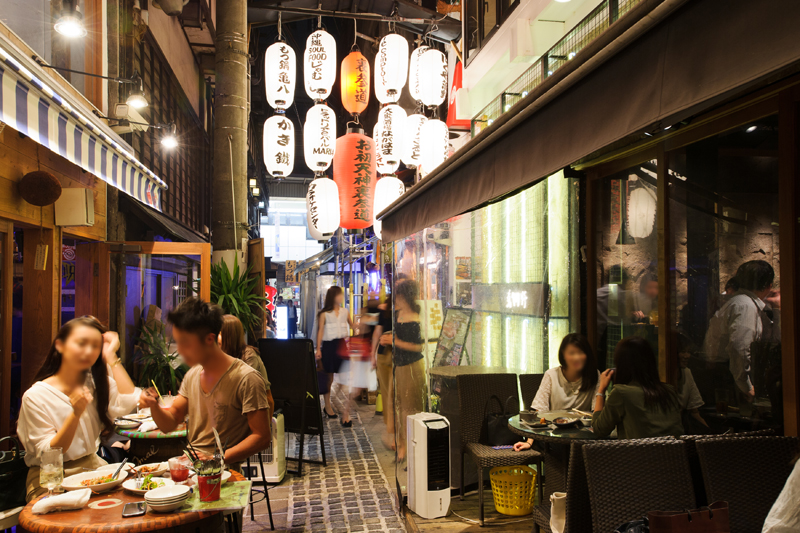
<!-- end_slide -->
Fri, Dec 18
---
# Hiking Tour
Not my wheelhouse, Megan can pitch things.
- https://www.klook.com/search/result/?query=osaka%20hiking&search_scope=main_search&date_range=2026-12-18&sort=most_relevant&tab_key=0&start=1&spm=SearchResult.Confirm&clickId=5f6f647240
- https://www.klook.com/activity/203723-osaka-katsuo-ji-maishima-park-full-day-small-group-tour/?spm=SearchResult.SearchResult_LIST&clickId=caa79aa12d
<!-- end_slide -->
Fri, Dec 18
---
Complete
<!-- end_slide -->
