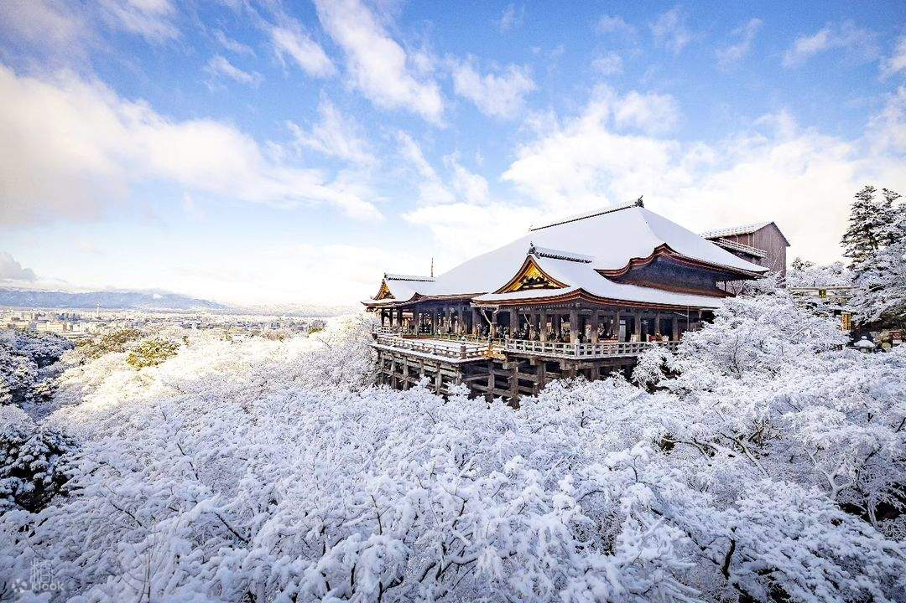
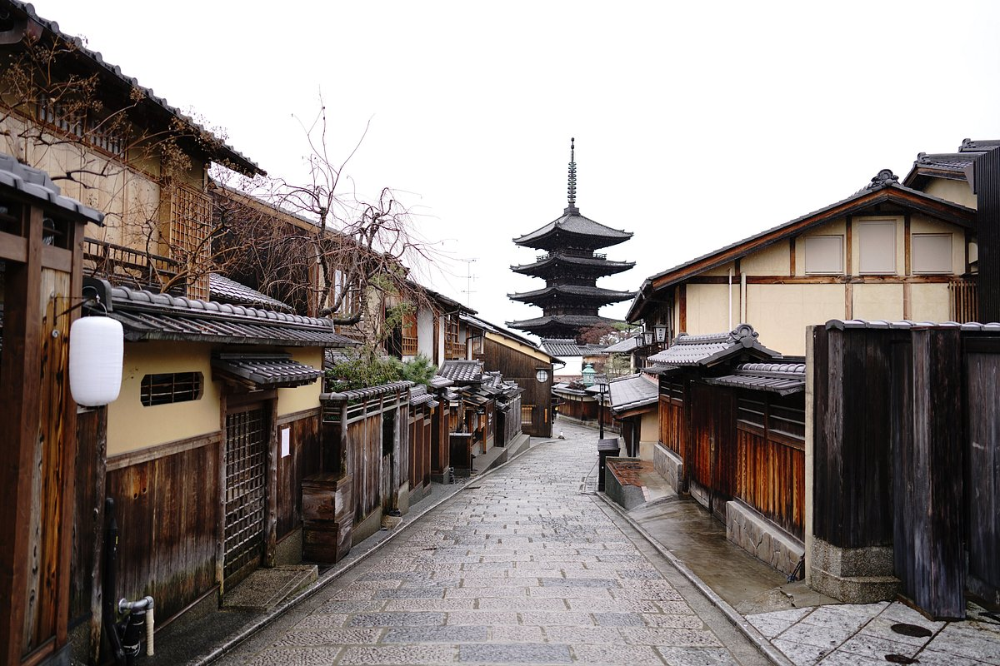
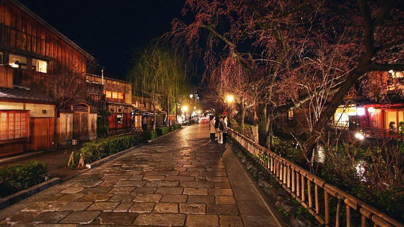
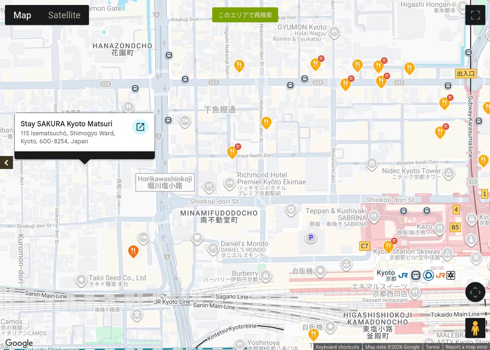
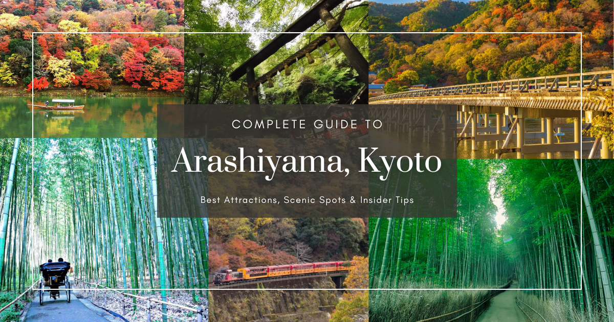
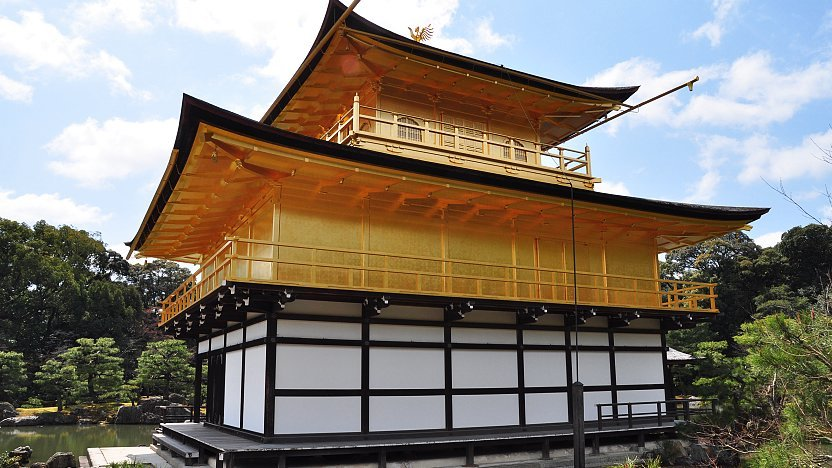
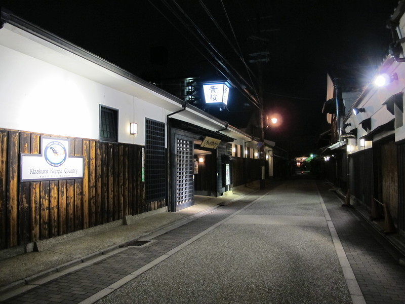

Agenda
---
* Complete Kansai
    * Kyoto
        * Schedule Overview
        * Reserve: ???
* Kanto
    * Tokyo
        * Schedule Overview
        * Reserve: ???
<!-- end_slide -->

Calendar
---
| Sun   | Mon      | Tue   | Wed          | Thu   | Fri   | Sat   |
|-------|----------|-------|--------------|-------|-------|-------|
|       | 14       | 15    | 16           | 17    | 18    | 19    |
|       | ARRIVE   | OSAKA | OSAKA/HIMEJI | NARA  | OSAKA | KYOTO |
|       |          |       |              |       |       |       |
| 20    | 21       | 22    | 23           | 24    | 25    | 26    |
| KYOTO | KINOSAKI | TOKYO | TOKYO        | TOKYO | TOKYO | TOKYO |
|       |          |       |              |       |       |       |
| 27    | 28       |       |              |       |       |       |
| TOKYO | DEPART   |       |              |       |       |       |
<!-- end_slide -->

Sat, Dec 19
---
**Higashiyama, Shimogyo (Geisha day) (Strictness: fairly high)**
| Time | Duration | Event |
|---|---|---|
| ~8:00 AM |  | Checkout early |
| ~8:15 AM | 15m | Taxi to Shin-Osaka Sta |
| ~8:30 AM | 30m | Figure out the Station |
| 9:05 AM | 25m | SHINKANSEN to Kyoto Sta |
| 9:30 AM | 35m | Store bags |
| 10:05 AM | 25m | Kyoto Sta -(bus)-> Gojozaka |
| 10:30 AM | 1h | Kiyomizu-Dera |
| 11:30 AM | 2h 45m | Lunch & Wander Higashiyama |
| 2:15 PM | 2h | 2:30 PM TEA CEREMONY |
| 4:15 PM | 3h 30m | Hanamikoji, Gion, Potoncho |
| 7:45 PM | 15m | Shijo Kawaramachi -(bus)-> Kyoto Sta |
| 8:15 PM | 15m | Walk to hotel |
| 8:30 PM | 30m | CHECKIN |
| 9:00 PM | 2h | Dinner around Shichijo in Shimogyo |
| 11:00 PM |  | Sleep |
<!-- end_slide -->

Sat, Dec 19
---
# Shinkansen

<!-- end_slide -->

Sat, Dec 19
---
# Hotel Guest Service Counter

<!-- end_slide -->

Sat, Dec 19
---
# Kiyomizu-dera
Massive area w/ several attractions, including the Spear of Benkei
10:30 AM - 11:30 AM

<!-- end_slide -->

Sat, Dec 19
---
# Higashiyama Ward
TONS of shrines, old towns, and food
11:30 AM - 2:30 PM

<!-- end_slide -->

Sat, Dec 19
---
# Tea Ceremony
2:30 PM - 4:00 PM

<!-- end_slide -->

Sat, Dec 19
---
# Gion & Potoncho
Geisha district
4:00 PM - 7:30 PM

<!-- end_slide -->

Sat, Dec 19
---
# Checkin
8:00 PM

<!-- end_slide -->

Sat, Dec 19
---
# Shimogyo
8:30 PM

<!-- end_slide -->

Sat, Dec 19
---
# Shimogyo Dinner
8:30 PM

<!-- end_slide -->

Sun, Dec 20
---
**Arashiyama, Kinkaku-ji, Fushimi (Hiking day) (Strictness: medium)**
| Time | Duration | Event |
|---|---|---|
| ~7:00 AM |  | Early start |
| ~7:15 AM | 45m | Kyoto Sta -(train)-> Saga-Arashiyama |
| 8:00 AM | 3h | Arashiyama Area |
| 11:00 AM | 30m | Arashiyama -(taxi)-> Kinkaku-ji |
| 11:30 AM | 1h | Kinkaku-ji |
| 12:30 PM | 1h 30m | Lunch @ Kita, Kyoto |
| 2:00 PM | 1h | Kinkakuji-michi -(bus,train)-> Fushimi-Inari |
| 3:00 PM | 3h 15m | Fushimi Inari (sunset before 5PM) |
| 6:15 PM | 30m | Fushimi-Inari -(train)-> Chushojima Sta |
| 6:45 PM | 2h 15m | Fushimi Sake District Dinner |
| 9:00 PM | 40m | Momoyamagoryo-Mae Sta -(train)-> Kyoto Sta |
| 9:40 PM |  | Sleep |
<!-- end_slide -->

Sun, Dec 20
---
# Arashiayama
Bamboo grove, hundreds of shrines, romantic train, preserved district, monkey park
8:00 AM - 11:30 AM

<!-- end_slide -->

Sun, Dec 20
---
# Kinkaku-ji
Golden pavilion
12:15 PM - 2:15 PM

<!-- end_slide -->

Sun, Dec 20
---
# Fushimi Inari
10,000 Tori gates
3:15 PM - 6:15 PM

<!-- end_slide -->

Sun, Dec 20
---
# Fushimi-ku
Sake District
6:15 PM - 9:15 PM

<!-- end_slide -->

Mon, Dec 21
---
**Kinosaki (Spa Day)**
| Time | Duration | Event |
|---|---|---|
| 9:00 AM | 1h | Checkout, forward luggage (hotel or Kyoto Sta) |
| 10:00 AM | 1h | Kyoto Sta -(train,train)-> Kinosakionsen Sta |
| 11:00 AM | 3h | Check Out Kinosaki  |
| 2:00 PM | 1h | Checkin, Yukata |
| 3:00 PM |  | Bathe & Eat & Sleep |
<!-- end_slide -->

Tue, Dec 22
---
**Train Day**
| Time | Duration | Event |
|---|---|---|
| 7:00 AM |  | Wake up, bathe, breakfast |
| 9:30 AM | 1h | Checkout & head to Kinosakionsen Sta |
| 10:20 AM | 6h | Kinosakionsen Sta -(train,shinkansen,train)-> Aoto Sta |
| 4:30 PM | 1h | Checkin |
| 5:30 PM | 5h | Get luggage from forwarding service, eat, explore |
| 10:30 PM |  | Sleep |
<!-- end_slide -->

Wed, Dec 23
---
**idk**
| Time | Duration | Event |
|---|---|---|
| 7:00 AM |  | Tokyo... |
| 9:30 AM | 1h | Checkout & head to Kinosakionsen Sta |
| 10:20 AM | 6h | Kinosakionsen Sta -(train,shinkansen,train)-> Aoto Sta |
| 4:30 PM | 1h | Checkin |
| 5:30 PM | 5h | Get luggage from forwarding service, eat, explore |
| 10:30 PM |  | Sleep |
<!-- end_slide -->

