Agenda
---
* Tokyo
    * Schedule Overview
    * Book: Eorzea Cafe (need headcount)
    * Book: Maid Cafe (need headcount)
    * Book: Teamlabs PLANETS (confirm date&time)
    * Book: Teamlabs BORDERLESS (confirm date&time)
<!-- end_slide -->

Tue, Dec 22
---
**Train Day**
| Time | Duration | Event |
|---|---|---|
| 7:00 AM | 1h 30m | Wake up, bathe, breakfast |
| 9:30 AM | 1h | Checkout & head to Kinosakionsen Sta |
| 10:20 AM | 6h | Kinosakionsen Sta -(train,shinkansen,train)-> Aoto Sta |
| 4:30 PM | 1h | Checkin |
| 5:30 PM | 5h | Get luggage from forwarding service, eat, explore |
| 10:30 PM |  | Sleep |
<!-- end_slide -->

Tokyo Map
---
We're going to see this again, but for now...

Our lodging is in the dead center of Katsushika, remember this!
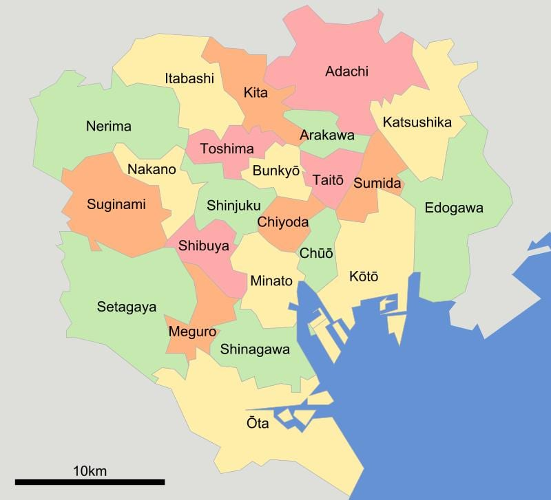
<!-- end_slide -->

Wed, Dec 23
---
**Taitou (Asakusa, Ueno), Chiyoda (Akihabara)**
**Culture then nerd city (Strictness: medium)**
| Time | Duration | Event |
|---|---|---|
| 7:30 AM | 25m | Aoto Sta -(train)-> Asakusa Sta |
| 8:00 AM | 1h | Sensou-ji |
| 9:00 AM | 25 | Asakusa Sta -(train)-> Ueno Sta |
| 9:30 AM | 2h 30m | Ueno - Tokyo National Museum |
| 12:00 PM | 16m | Ueno Sta -(train)-> Akihabara Sta |
| 12:30 PM | 1h 30m | **Eorzea Cafe** |
| 2:00 PM | 2h | Explore Akihabara |
| 4:00 PM | 1h 30m | **Maid Cafe** |
| 5:30 PM | 2h | Explore Akihabara |
| 7:30 PM | 1h 30m | **Maid Cafe** |
| 9:00 PM | 1h 30m | Last chance for shopping |
| 10:30 PM | 40m | Suehirochou Sta -(train,train)-> Aoto Sta |
| 11:10 PM |  | Sleep |
<!-- end_slide -->
Wed, Dec 23
---
# Map
Katsugashika->Taitou->Chiyoda

<!-- end_slide -->
Wed, Dec 23
---
# Sensouji
8:00 AM - 9:00 AM

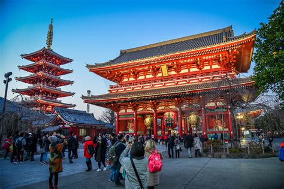
<!-- end_slide -->
Wed, Dec 23
---
# Ueno
9:30 AM - 12:00 PM

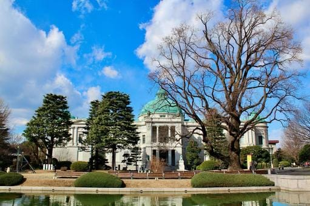
<!-- end_slide -->
Wed, Dec 23
---
# Tokyo National Museum
9:30 AM - 12:00 PM

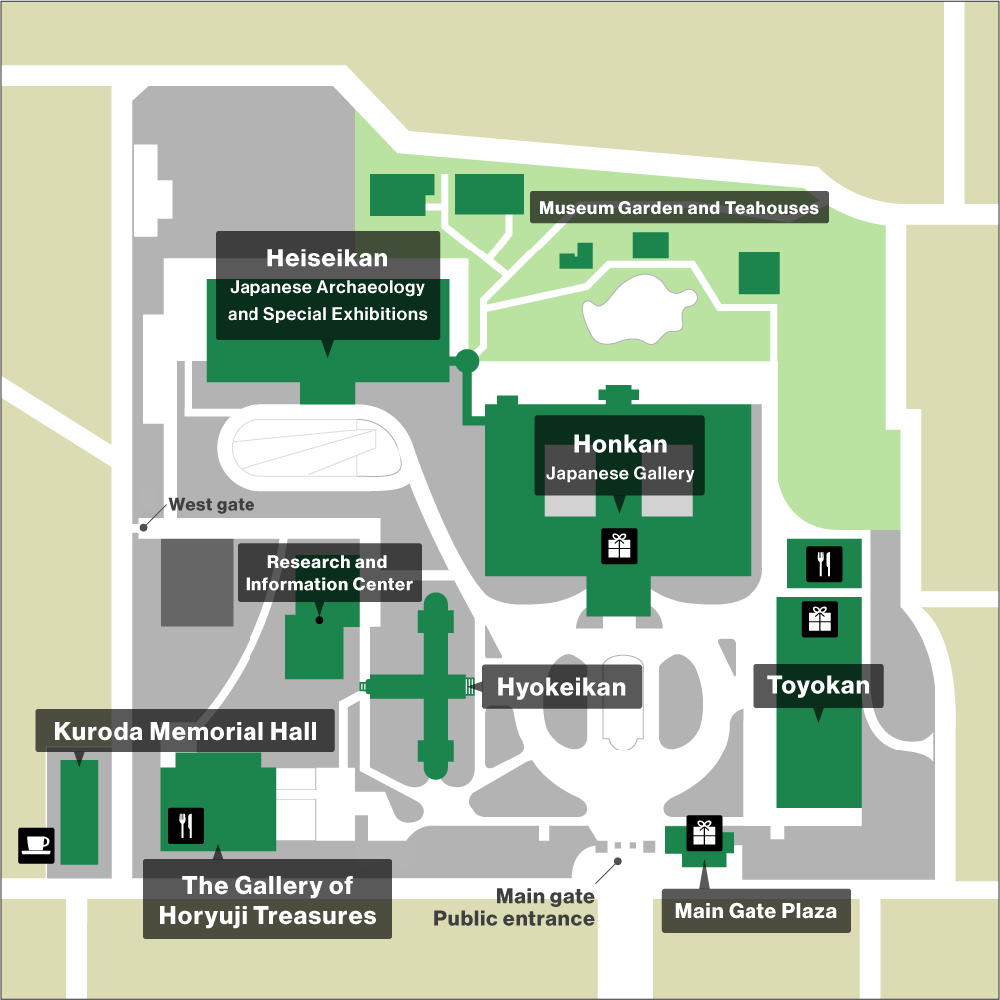
<!-- end_slide -->
Wed, Dec 23
---
# Akihabara - Eleectric Town
12:30 PM - as late as you want really

Main attractions: anime and gaming shops, maid cafes, pochinko...

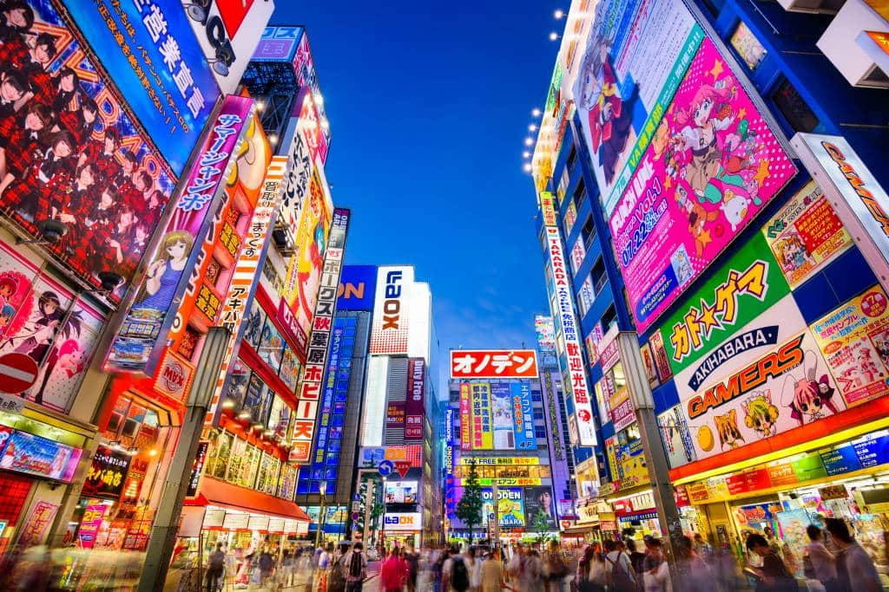
<!-- end_slide -->

Thu, Dec 24
---
**Shinagawa(Takanawa), Minato(Roppongi)**
**Architecture, Museums, and Christmas (Strictness: low)**
| Time | Duration | Event |
|---|---|---|
| 8:00 AM | 1h | Aoto Sta -(train)-> Takanawa Gateway Sta |
| 9:00 AM | 1h | Explore Takanawa Gateway |
| 10:00 AM | 2h | Museum of Narratives |
| 12:00 PM | 2h | Explore Takanawa Gateway |
| 2:00 PM | 30m | Sengakuji Sta -(bus)-> Iigura-Katamachi |
| 2:30 PM | 2h 30m | **Teamlabs BORDERLESS** |
| 5:00 PM | 1h | Roppongi Hills Xmas Market |
| 6:00 PM | 4h | Roppongi Hills |
| 10:00 PM | 55m | Roppongi Sta -(train,train)-> Aoto Sta |
| 11:00 PM |  | sleep |
<!-- end_slide -->
Thu, Dec 24
---
# Map
Katsugashika->Shinagawa->Minato

<!-- end_slide -->
Thu, Dec 24
---
# Takanawa Gateway
9:00 AM - 2:00 PM

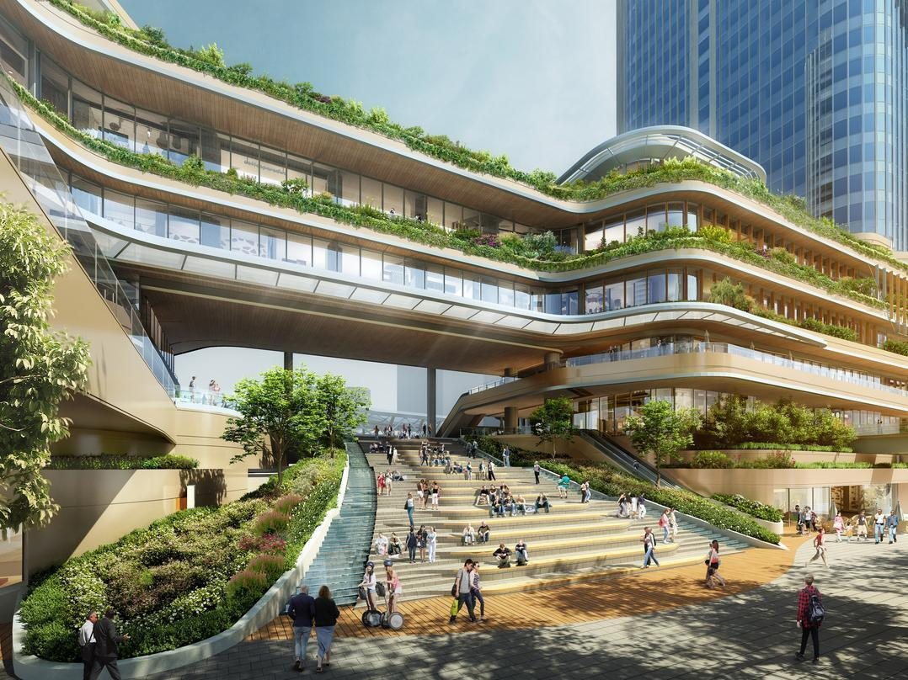
<!-- end_slide -->
Thu, Dec 24
---
# Museum of Narratives
10:00 AM - 12:00 PM

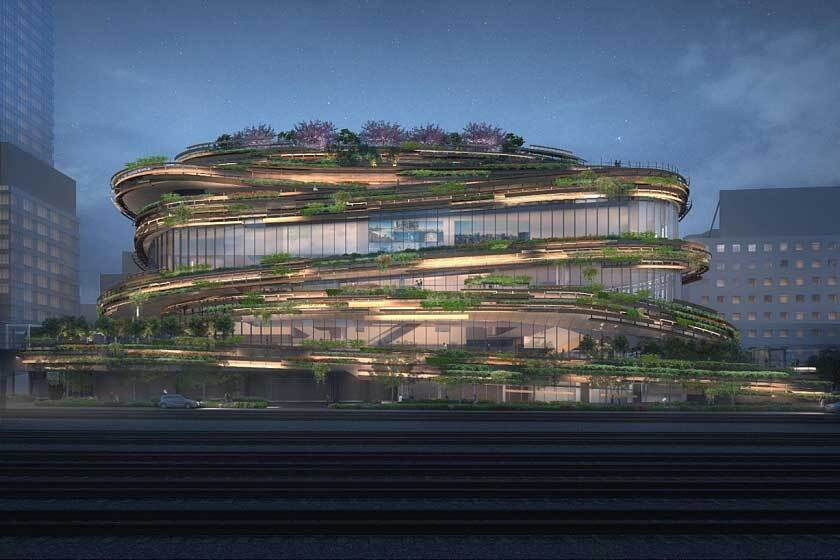
<!-- end_slide -->
Thu, Dec 24
---
# Teamlabs BORDERLESS
2:30 PM - 5:00 PM

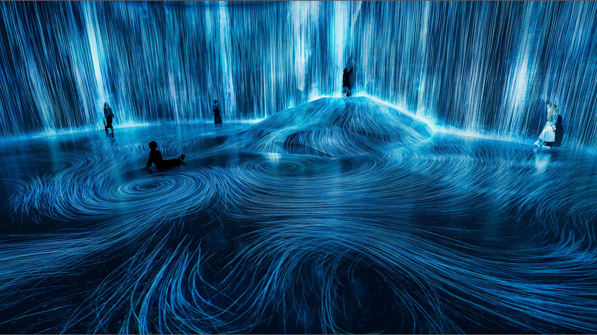
<!-- end_slide -->
Thu, Dec 24
---
# Roppongi Christmas Market
5:00 PM - 6:00 PM

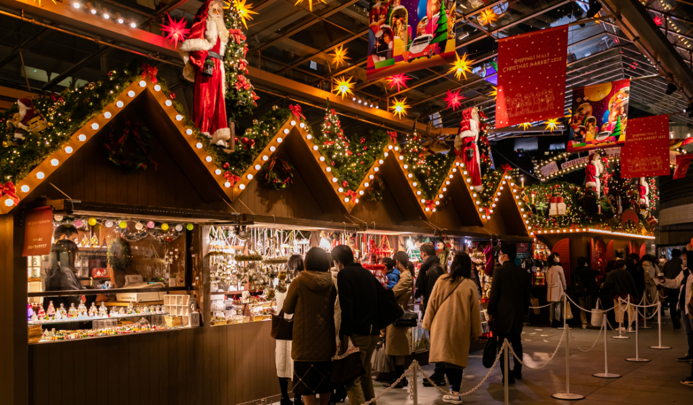
<!-- end_slide -->
Thu, Dec 24
---
# Roppongi Hills
6:00 PM - as late as you want really

Spendy area with great food and drinks
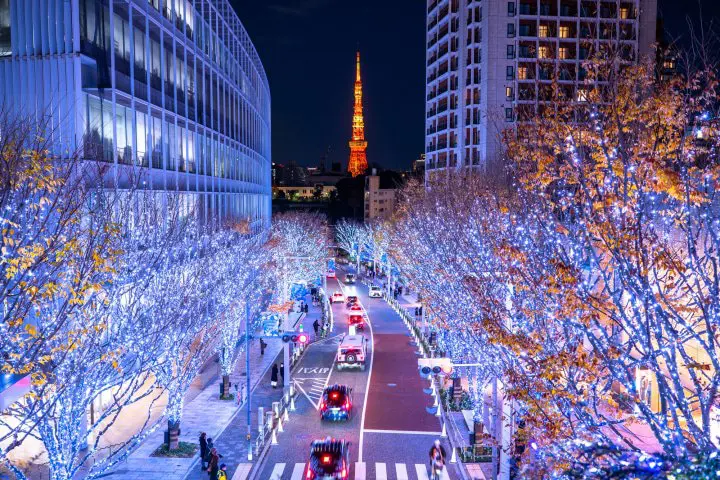
<!-- end_slide -->

Fri, Dec 25
---
**Chuuou (Tsukiji, Ginza), Koto (Tosuyu, Odaiba), Sumida (Tokyo Skytree)**
**Xmas Bay Day (Strictness: two things)**
| Time | Duration | Event |
|---|---|---|
| 7:00 AM | 50m | Kiba-Kouen -(bus)-> Tsukiji 6 |
| 8:00 AM | 3h | Tsukiji Fish Market and/or Explore Ginza |
| 11:00 AM | 1h | **Kabuki-za Theater** |
| 12:00 PM | 20m | Tsukiji -(bus)-> Shin-Toyosu Sta |
| 12:20 PM | 2h 40m | **Teamlabs PLANETS** |
| 3:00 PM | 1h 20m | Toyusu Christmas Village |
| 4:20 PM | 20m | Shin-Toyosu Sta -(train)-> Telecom Center Sta |
| 4:40 PM | 2h 20m | Odaiba |
| 7:20 PM | 1h | Telecom Center Sta -(train,train)-> Oshiage Sta |
| 8:20 PM | 2h 30m | Tokyo Skytree & Area |
| 11:00 PM | 15m | Oshiage Sta -(train)-> Aoto Sta |
| 11:15 PM |  | Sleep |
<!-- end_slide -->
Thu, Dec 24
---
# Map
Katsugashika->Chuuou->Koto->Sumida

<!-- end_slide -->
Fri, Dec 25
---
# Tsukiji Fish Market
8:00 AM - 11:00 AM

Morning sushi & snacks

<!-- end_slide -->
Fri, Dec 25
---
# Ginza
8:00 AM - 11:00 AM

Huge retail markets
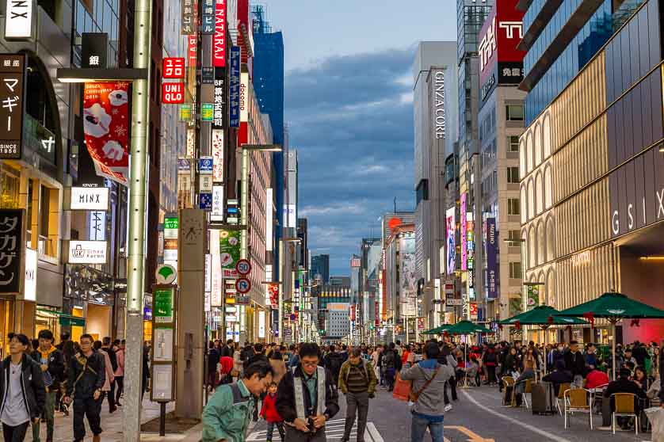
<!-- end_slide -->
Fri, Dec 25
---
# Kabuki-za
11:00 AM - 12:00 PM
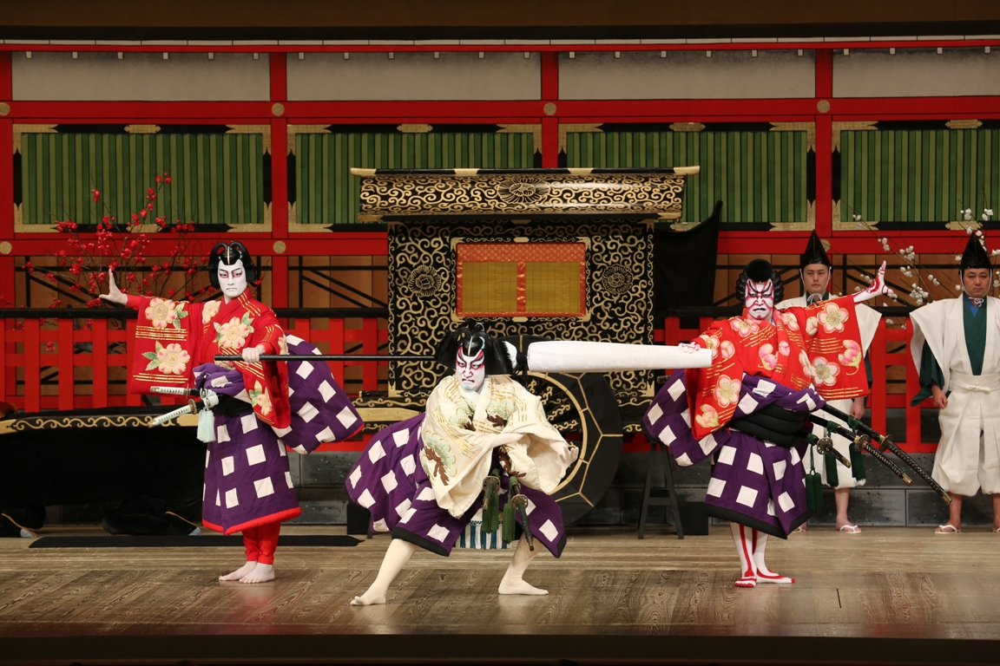
<!-- end_slide -->
Fri, Dec 25
---
# Teamlabs PLANETS
12:20 PM - 3:00 PM
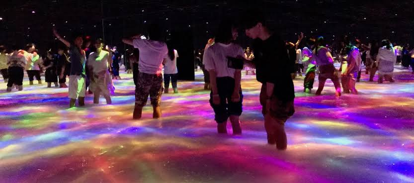
<!-- end_slide -->
Fri, Dec 25
---
# Tosuyu Christmas Market
3:00 PM - 4:20 PM
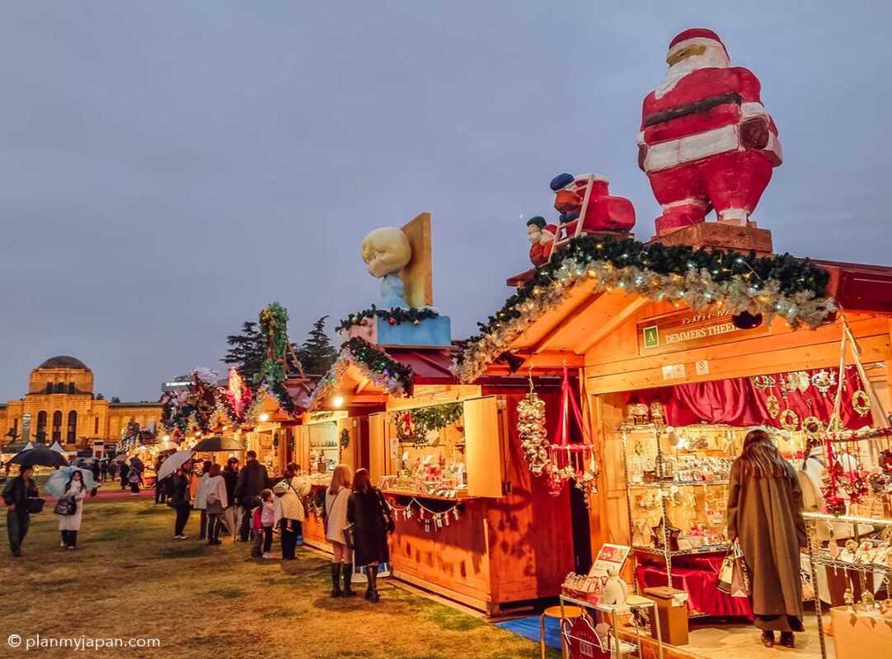
<!-- end_slide -->

Sat, Dec 26
---
**Setagaya, Shimokita, Shibuya (Scramble day) (Strictness: none)**
| Time | Duration | Event |
|---|---|---|
| 9:00 AM | 1h 30m | Aoto Sta -(train,train)-> Todoroki Sta |
| 10:30 AM | 1h 30m | Todoroki Ravine Park |
| 12:00 PM | 45m | Todoroki Sta -(bus,train)-> Higashi-Kitazawa Sta |
| 12:45 PM | ~3h | Shimokitazawa |
| 3:40 PM | 20m | Shimo-Kitazawa Sta -(train)-> Shibuya Sta |
| 4:00 PM | 6h | Shibuya |
| 10:00 PM | 1h | Shibuya Sta -(train,train)-> Aoto Sta |
| 11:00 PM |  | Sleep |
<!-- end_slide -->

Sat, Dec 26
---
**Shinjuku, Ikebukuro, Nakano (Shopping day) (Strictness: one thing)**
These hours are whatever, you can stay longer where you are having fun.
Just don't miss the butler cafe reservation.
| Time | Duration | Event |
|---|---|---|
| 8:00 AM | 45m | Aoto Sta -(train,train)-> Shinjuku Sta |
| 8:45 AM | 30m | Get a coin locker in Shinjuku Sta |
| 9:15 AM | 1h 30m | Explore Shinjuku Plaza |
| 10:45 AM | 15m | Shinjuku Sta -(train)-> Ikebukuro Sta |
| 11:00 AM | 2h | Explore Ikebukuro |
| 1:00 PM | 1h 20m | **Swallowtail Butler Cafe** |
| 2:20 PM | 15m | Ikebukuro Sta -(train)-> Shinjuku Sta |
| 2:35 PM | 30m | Store shopping in locker |
| 3:05 PM | 20m | Shinjuku Sta -(train)-> Nakano Sta |
| 3:25 PM | 2h 15m | Nakano Broadway |
| 5:40 PM | 15m | Nakano Sta -(train)-> Shinjuku Sta |
| 5:55 PM | 35m | Store shopping in locker |
| 6:30 PM | 3h 30m | Explore Shinjuku (Evening & Drinks) |
| 10:00 PM | 30m | Retrieve shopping from locker |
| 10:30 PM | 50m | Shinjuku Sta -(train,train)-> Aoto Sta |
| 11:20 PM |  | Sleep |
<!-- end_slide -->

